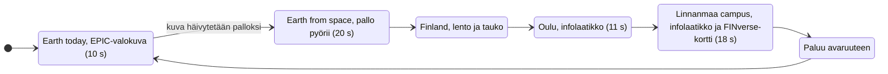
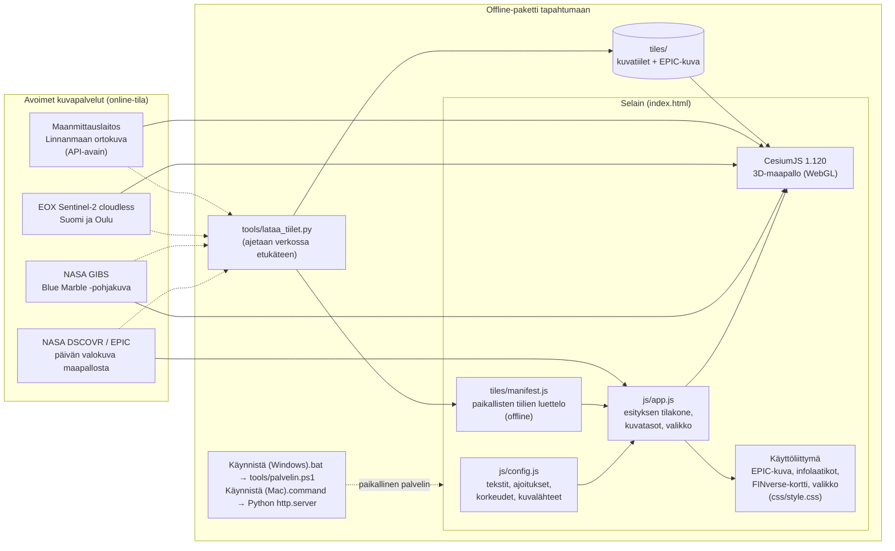

# Maapallo – Oulu

Pyörivä 3D-maapallo, joka lentää automaattisesti Suomeen ja Oulun yliopiston Linnanmaan kampukselle. Sivun tekstit ovat englanniksi. Tehty FINverse- ja Ouluversumi-hankkeiden esittelyyn.

## Verkkoversio

Toimii sellaisenaan staattisena sivuna (esim. GitHub Pages). Kuvat haetaan suoraan NASAn ja Copernicuksen avoimista palveluista.

## Offline-versio tapahtumaan

1. **Kun verkko on käytössä** (esim. edellisenä päivänä), lataa kuvatiilet:
   ```
   python tools/lataa_tiilet.py --nls-key OMA_AVAIN
   ```
   Lataa noin 6 500 tiiltä ja tuoreimman EPIC-valokuvan (pohjakuva, Suomi ja Oulu tarkkana, `--nls-key` lisää Linnanmaan ilmakuvan). Keskeytyneen latauksen voi ajaa uudelleen, jo ladatut ohitetaan.
2. **Tapahtumassa** tuplaklikkaa `Käynnistä (Windows).bat` tai `Käynnistä (Mac).command`. Selain avautuu ja esitys käyttää vain paikallisia tiedostoja. Paina F, niin esitys menee koko näytölle, ja H, jos haluat piilottaa valikon.

Selain ei aja 3D-moottoria suoraan tiedostosta, joten käynnistystiedosto avaa pienen paikallisen palvelimen (Windowsissa PowerShell, Macissa Python). Mitään ei tarvitse asentaa.

`?light` osoitteen perässä kevyempi tila heikoille koneille. `?offline` osoitteen perässä pakottaa offline-tilan. Ilman ladattuja tiiliä offline-tila näyttää Cesiumin mukana tulevan Natural Earth -kartan.

## Valikko ja näppäimet

Oikeassa yläkulmassa on valikko:

- **Source:** Online (kuvat suoraan NASAlta, Copernicukselta ja Maanmittauslaitokselta) tai Offline (vain kansion `tiles/` kuvat)
- **Quality:** Sharp (näytön täysi tarkkuus) tai Light (heikoille koneille)
- **Show:** Pause, Restart, Fullscreen
- **Go to:** siirtymäpainikkeet suoraan näkymään: maapallo-ikoni (Earth), Suomen lippu (Oulu) ja valmistujaislakki (Linnanmaa campus). Aktiivisen näkymän painike on korostettu.
- Ruudunpäivitysnopeus (FPS) näkyy valikon alareunassa

| Näppäin | Toiminto |
|---|---|
| Välilyönti | Tauko / jatka |
| R | Aloita alusta |
| F | Koko näyttö |
| H | Piilota / näytä valikko |

## Esityksen kulku

Esitys on tilakone (`run()` tiedostossa `js/app.js`), joka toistuu silmukkana. Go to -painikkeet hyppäävät suoraan haluttuun tilaan.



Kestot ja kameran korkeudet ovat `js/config.js`:n kohdissa `timing` ja `heights`.

## Arkkitehtuuri

Sovellus on staattinen verkkosivu ilman palvelinpuolen koodia tai build-vaihetta. Selain lataa skriptit järjestyksessä `vendor/cesium/Cesium.js` → `js/config.js` → `tiles/manifest.js` → `js/app.js`.



**Kuvatasot päällekkäin (alimmasta ylimpään):**

1. Blue Marble (NASA GIBS), koko maapallo, tasot 0–8
2. Sentinel-2 cloudless (EOX), tarkka kuva, tasot 3–15
3. Maanmittauslaitoksen ortokuva, vain Oulun seudulla, tasot 11–16. Kuva häivytetään esiin vasta, kun kamera laskeutuu alle 22 km:n korkeudelle, jotta sen reuna ei erotu.

**Online vai offline:** `js/app.js` kokeilee käynnistyessään, vastaako NASA GIBS. Jos vastaa, kuvat haetaan verkosta. Muuten käytetään `tiles/manifest.js`:n luettelemia paikallisia tiiliä, ja jos niitäkään ei ole, Cesiumin mukana tulevaa Natural Earth -karttaa. Offline-tilan voi pakottaa valikosta tai osoitteen parametrilla `?offline`.

**EPIC-kuvan valinta:** päivän kuvista valitaan se, jonka keskikohta on noin 120° Oulusta itään. Näin pyöriminen päättyy luontevasti Suomen kohdalle. Jos kuvaa ei saada, esitys alkaa suoraan 3D-pallosta, ja selaimen konsoliin (F12) tulee `EPIC:`-alkuinen syy.

## Tiedostot

| Tiedosto | Tehtävä |
|---|---|
| `index.html` | Sivun rakenne: maapallo, EPIC-kuva, infolaatikko, FINverse-kortti, valikko |
| `css/style.css` | Ulkoasu (oranssi hologrammityyli, valikko, animaatiot) |
| `js/config.js` | Kaikki muokattavat tekstit, ajoitukset, korkeudet ja kuvalähteet |
| `js/app.js` | Esityksen logiikka: Cesium-näkymä, kuvatasot, tilakone, infolaatikot, valikko |
| `tiles/manifest.js` | Offline-tiilien luettelo (latausskripti kirjoittaa sen) |
| `tools/lataa_tiilet.py` | Lataa offline-tiilet ja EPIC-kuvan |
| `tools/palvelin.ps1` | Windowsin paikallinen palvelin |
| `Käynnistä (Windows).bat`, `Käynnistä (Mac).command` | Offline-esityksen käynnistys |
| `vendor/cesium/` | CesiumJS-3D-moottori |

## Linnanmaan ilmakuva

Linnanmaan lähikuva on Maanmittauslaitoksen uusin ortokuva (ilmakuva, 0,5 m tarkkuus, CC BY 4.0). Se vaatii maksuttoman API-avaimen, joka kirjoitetaan tiedostoon `js/config.js` kohtaan `aerial.apiKey`. Ilman avainta lähikuvana on Sentinel-2-satelliittikuva, ja kamera jää korkeammalle.

## Asetukset

Tekstit, ajoitukset, korkeudet ja kuvalähteet ovat tiedostossa `js/config.js`. Infolaatikoiden sisältö on kohdissa `oulu` ja `campusInfo`, ja FINverse-kortin tekstit kohdassa `texts`. Merkintä `{daylight}` korvataan päivän valoisan ajan pituudella Oulussa, joka lasketaan automaattisesti.

Vaihtoehtoinen ulkoasu, jossa kampuksen ilmakuvaa himmennetään, saadaan osoitteen parametrilla `?look=b`.

## Kuvalähteet (avoin data)

- **NASA DSCOVR / EPIC**: aito valokuva koko valaistusta maapallosta noin 1,5 milj. km:n päästä. Esitys alkaa tällä kuvalla, joka vaihtuu 3D-palloksi. Tuorein kuva haetaan automaattisesti (julkaisuviive yleensä 12–36 h); offline-latausskripti lataa sen mukaan.

- **NASA GIBS, Blue Marble Next Generation**: pilvetön koko maapallon pohjakuva.
- **Sentinel-2 cloudless 2021, EOX IT Services GmbH** (sisältää muokattua Copernicus Sentinel -dataa 2021): tarkka pilvetön kuva Suomesta ja Oulusta. Lisenssi CC BY-NC-SA 4.0 (ei-kaupallinen käyttö).
- **Maanmittauslaitos, ortokuva**: uusin ilmakuva Linnanmaalta (CC BY 4.0, vaatii API-avaimen).
- Ilman verkkoyhteyttä: paikalliset tiilet kansiosta `tiles/` tai Cesiumin mukana tuleva Natural Earth II.

3D-moottori: [CesiumJS](https://cesium.com/platform/cesiumjs/) 1.120 (Apache 2.0), mukana kansiossa `vendor/cesium`.
